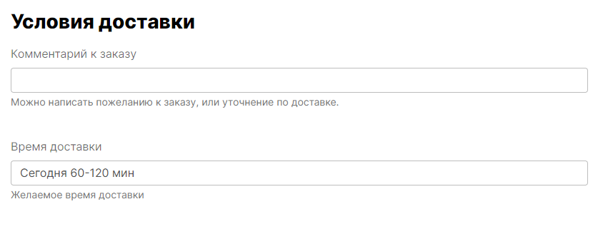

<p align="center">

</p>

## Form Builder 
Кароч изи пакет для инпутов. На основе ботсрапа.
  

 

## Установка
1) Установить из композера 
```  
composer require slavawins/formbuilder
```

2) Опубликовать js файлы необходимые для работы пакета.
Вызывать команду:
   ```
   php artisan vendor:publish --provider="SlavaWins\Formbuilder\Providers\FormbuilderServiceProvider"
   ``` 
После этого в папке public_html/js/ будут созданы 3 джс файла нужные для использования пакета

3) Подключить js файлы в любом удобном месте. Можно просто в app.blade.php
 ```
    <script src="{{ asset('js/formbuilder/formBuilderHelper.js') }}"></script>
    <script src="{{ asset('js/formbuilder/InputValidatorValues.js') }}"></script>
    <script src="{{ asset('js/formbuilder/ApprovedModalController.js') }}"></script>
 ```
ApprovedModalController - стоит поместить вниз где footer. Что бы jquery успел прогрузится.

## Использваоние

Открываете вью в котором хотите создать поля. И добавляете в нем зависимость
 ```
@php
    use SlavaWins\Formbuilder\Library\FElement;
@endphp
 ```

Затем в нужном месте пишете такой блок.
Это создаст поле в две колонки. Слева будет лейбл. Справа инпут.
Снизу будет описание
Он автокомплитестся.
 ```
@php
    FElement::NewInputTextRow()
        ->SetLabel("Лебл поля")
        ->SetName("amountPrice")
        ->SetValue(old("amountPrice", "test"))
        ->SetDescr("В какую суммы вы готовы уложится?")
        ->RenderHtml(true);
@endphp
 ```
 

След пример добавить фронтенд валидацию для суммы  ->FrontendValidate()->Money()
 ```
@php
    FElement::NewInputTextRow()
        ->SetLabel("Лебл поля")
        ->SetName("amountPrice")
        ->FrontendValidate()->Money()
        ->SetValue(old("amountPrice", "test"))
        ->SetDescr("В какую суммы вы готовы уложится?")
        ->RenderHtml(true);
@endphp
 ```

Этот пример создаст фронтенд валидацию с требованием ввести от 15 до 120 символов
 ```
 @php
    FElement::NewInputTextRow()
     ->SetLabel("Название заказаа")
     ->SetName("title")
     ->FrontendValidate()->String(15,120)
     ->SetPlaceholder("Например: Нужно отправить груз")
     ->SetDescr("Кратко опишите суть заказа")
     ->SetValue(old("title", "Example text") )
     ->RenderHtml(true);
@endphp
 ```

Следующий пример это апров модалка. Вы просто пишите в ссылке тег approvedModal, и на фронтенде при нажатии
на кнопку будет выскакивать модалка переспрашивающие нажатие кнопки
 ```
   <a class="btn "
           href="/delete"
           approvedModal="Вы действительно хотите удалить этот объект?"
        >Удалить</a>
 ```

К этой штуке нужно подключить вью. Можно сделать 
 ```
@include("formbuilder::approved-modal")
 ```


## Кастомизация.
Создайте у себя:
 ```
resources\views\formbuilder\component
 ```

Скопируйте туда всё с:

 ```
vendor\slavawins\formbuilder\src\resources\views\component
 ``` 

Теперь вы можете кастомизировать элементы формы, прямо у себя в проекте. 


## Документация

Fluent-построитель Bootstrap-полей для Blade. На нём держится вывод форм в mrproperter и adminwinda.

### Подключение
```
php artisan vendor:publish --provider="SlavaWins\Formbuilder\Providers\FormbuilderServiceProvider"
```
```blade
<script src="{{ asset('js/formbuilder/formBuilderHelper.js') }}"></script>
<script src="{{ asset('js/formbuilder/InputValidatorValues.js') }}"></script>
<script src="{{ asset('js/formbuilder/ApprovedModalController.js') }}"></script> {{-- в конце, после jQuery --}}
@include('formbuilder::approved-modal')
```

### Пример
```php
use SlavaWins\Formbuilder\Library\FElement;

FElement::NewInputTextRow()
    ->SetLabel('Название')->SetName('title')
    ->SetPlaceholder('Например: …')->SetDescr('Кратко')
    ->FrontendValidate()->String(15, 120)
    ->SetValue(old('title', $model->title))
    ->RenderHtml(true);           // true = echo, иначе вернёт строку
```

### API `FElement`
- Фабрики: `New()`, `NewInputText()`, `NewInputTextRow()`.
- Данные: `SetLabel`, `SetName`, `SetValue`, `SetPlaceholder`, `SetDescr`, `SetClass`, `SetPrefix`, `SetPostfix`, `SetDataMask($mask, $reverse)`, `AddOption($k, $text, $selected)`, `AddOptionFromArray($arr, $selectedKey)`, `AddValueAttributeCheckbox($v)`, `SetExampleModel($class)`, `CheckboxAttachHideDiv($checkboxName, $reverse)`.
- Вид, `SetView()->…`: `InputText`, `InputTextRow`, `InputBoolRow`, `InputSelect`, `InputSelectRow`, `BtnSubmit`, `H`, `Tabs`, `ListGenericClass`, `ContainerEmptyHtml`, `ContainerCardSettings`.
- Тип `<input>`, `SetType()->…`: `Text`, `Number`, `Int`, `Date`, `ListGenericClass`.
- JS-валидация, `FrontendValidate()->…`: `String($min,$max)`, `Digital($min,$max)`, `Money()`, `InnAny()`, `Custom($name)`.
- Вложенность: `$card->NewElement()` / `$card->AddElement($el)`. Дочерние элементы рендерятся внутрь контейнера.
- `SetForm($url, $method)` оборачивает результат в `<form>` c `@csrf` (и `_method` для PUT/PATCH/DELETE); url и method экранируются.

### Модалка подтверждения
```html
<a href="/page" approvedModal="Перейти?">Перейти</a>                              <!-- GET-переход -->
<a href="/delete/5" approvedModal="Точно удалить?" approvedModal-method="POST">Удалить</a>
<a href="/item/5" approvedModal="Удалить?" approvedModal-method="DELETE">Удалить</a>   <!-- POST + _method -->
```
Для не-GET методов отправляется скрытая форма с `_token` из `<meta name="csrf-token">`. Изменяющие действия делайте только так, а не GET-ссылкой.

### Кастомизация
Скопируйте `vendor/slavawins/formbuilder/src/resources/views/component` в `resources/views/formbuilder/component`. Сначала ищется вьюха проекта, потом пакетная `formbuilder::`.
